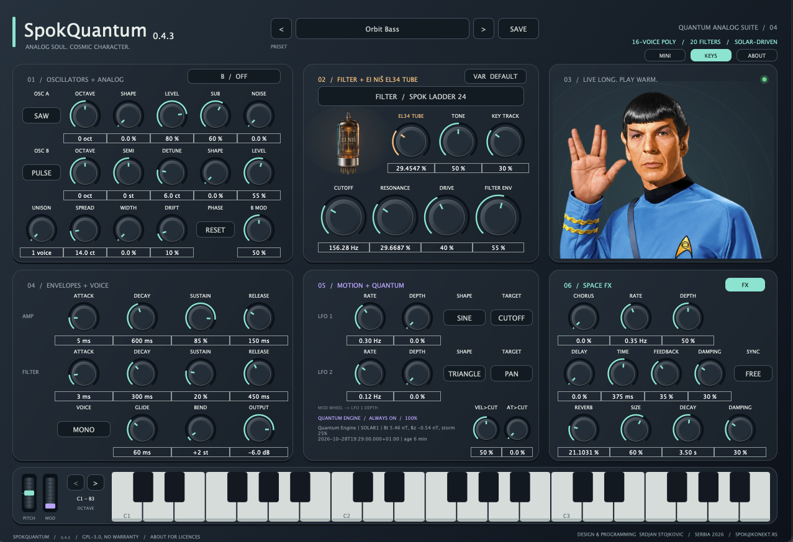

# SpokQuantum 0.4.4 — Solar-Driven Polyphonic Synthesizer

<p align="center">
  <strong>Analog soul. Cosmic character. Shaped in real time by the magnetic field of the Sun.</strong>
</p>

<p align="center">
  A 16-voice polyphonic VST3 synthesizer powered by the <strong>Spok Quantum Engine</strong> —
  combining zero-delay-feedback ladder filtering, 20 filter models, an oversampled
  EI Niš EL34 tube saturation stage, space effects, and live NOAA solar-wind telemetry
  that subtly modulates the analog character of the instrument as the Sun breathes.
</p>

<p align="center">
  16-Voice Polyphony · 20 Filter Models · Osc Sync / FM / Ring · EI Niš EL34 Tube · Live Solar Telemetry · Chorus · Tempo Delay · Cosmic Reverb
</p>

<p align="center">
  <a href="https://github.com/spok-sto/SpokQuantum">
    
  </a>
  
  
  
  
  
  <a href="LICENSE.md">
    
  </a>
</p>

<p align="center">
  <a href="docs/spok-Quantum.png">
    
  </a>
</p>

---

## What's new in 0.4.4
-The EL34 tube stage is at the output whit new tube model with a load line.
-Saw and Pulse use a 4-point BLEP.

---

## Why Spok Quantum?

Digital synthesizers often fail in one of two ways: either they are sterile and predictable, or they drown the mix in artificial random detuning that pulls chords out of tune.

Spok Quantum builds calibrated hardware behavior into every voice — and connects the circuit to the real universe.

Every voice card has its own fixed component tolerances (cutoff, resonance, envelope timing, pulse width, and ±1.5 cent tuning), while the **Quantum Engine** reads live measurements of the solar wind from NOAA's DSCOVR / ACE satellites at the L1 Lagrange point.

- **No two days on the Sun sound quite the same**
- **Always in tune** — solar pitch drift stays strictly bounded within ±2 cents
- **Works offline** — without internet access, the synth plays with its factory-calibrated 50% analog character and zero network overhead on the audio thread
- **16-voice polyphony** (up to 256 oscillators across the instrument with 7× unison per oscillator)
- **ZDF / TPT Spok Ladder 24** — zero-delay-feedback 4-pole nonlinear ladder filter with true self-oscillation
- **2× oversampled EI Niš EL34 tube stage** — half-band Kaiser oversampling eliminates harsh aliasing on hard-driven tubes 
- **Oscillator B cross-modulation** — Hard Sync, FM, and Ring Modulation driven by Oscillator A with dedicated `B MOD` depth
- **Filter Variants (`VAR`) + Velocity & Aftertouch to Cutoff** (`VEL>CUT`, `AT>CUT`)
- **Stronger Quantum Engine solar coupling** — live interplanetary magnetic field (`Bt`, `Bz`, geomagnetic storm index) drives filter cutoff, tube drive, storm wobble, circuit static
- **Host tempo-synced Delay** (`1/4`, `1/8`, `1/16`, dotted & triplets) with dedicated `DAMPING` control
- **Unique per-instance voice-card calibration** saved with your DAW session
---

## Signal & Solar Telemetry Flow

> **How does a note travel through Spok Quantum?**

```text
MIDI In (Note / Vel / Aftertouch / Pitch Bend ±1–24 st / Mod Wheel / Sustain)
  │
  ▼
[01] OSCILLATORS × 16 VOICES (up to 7× Unison + Sub + Noise)
     ├── Osc A (Saw / Pulse / Tri / Sine + Shape wavefolder)
     ├── Osc B (Hard Sync / FM / Ring Mod from Osc A via B MOD)
     └── Per-voice card tolerances + VCO jitter + warm-up drift 
[02] QUANTUM ENGINE (Live NOAA Solar Wind @ 1 req/min, background thread)
     └── Bt: 9.17 nT │ Bz: +5.07 nT │ Storm: 32% ──► Drift

 │
 ▼
     
[03] STEREO FILTER BANK (20 Models + VAR Flavours)
     ├── Spok Ladder 24 (ZDF 4-pole nonlinear self-oscillating ladder)
     └── 19 Surge-derived LP / BP / HP / Notch / Comb / Tri-Pole filters
  │
  ▼
[04] SPACE FX CHAIN
     └── Quadrature Chorus ──► Tempo-Synced Stereo Delay ──► Cosmic Reverb2
 │
 ▼
[05] EI NIŠ EL34 TUBE STAGE (2×  Oversampled)
     └── Asymmetric pentode saturation +

```

---

## Features

| | Module | What it delivers |
|---|---|---|
 **01 / Oscillators + Analog** | 2 main oscillators with continuous Shape, 7× stereo unison, Hard Sync / FM / Ring Mod (`B MOD`), Sub-oscillator, Noise, and Reset / Free-Run phase |
 **02 / Filter + EI Niš EL34** | 20 stereo filter models with `VAR` flavours, smooth click-free switching, and a 2× oversampled EL34 pentode tube stage |
 **03 / Live Long. Play Warm.** | Visual solar telemetry link — green/red satellite status LED and Spock's salute animated by solar wind strength (`Bt`) and geomagnetic unrest (`storm`) |
 **04 / Envelopes + Voice** | Dual analog-curve ADSR envelopes (1 ms to 12 s), 16-voice Poly / Mono / Legato with Low/High priority, polyphonic Glide, and adjustable Pitch Bend (1–24 st) |
 **05 / Motion + Quantum** | 2 LFOs (5 shapes, 5 targets), Mod Wheel routing, `VEL>CUT` & `AT>CUT`, and the always-on **Quantum Engine** fed by live NOAA solar-wind data |
 **06 / Space FX** | Stereo quadrature Chorus, tempo-synced modulated Delay with Damping, and lush algorithmic Reverb (up to 30 s decay) |
 **Full / Mini + Keys** | Switchable `FULL` (1280 px) and `MINI` (760 px) views, on-screen 3-octave keyboard with Pitch/Mod wheels, and computer-keyboard play (`A W S E D F...`) |
 **26 Factory Presets** | Curated Pads, Atmospheres, Leads, Keys, Plucks, and Basses + unlimited user presets |

---

## Repository structure & Downloads

This repository contains pre-built **VST3 binary releases** (no source build required):

```text
SpokQuantum/
├── Vst3_macoSX_arm/
│   └── Spok Quantum.vst3          # macOS Apple Silicon (M1 / M2 / M3 / M4) native VST3
├── Vst3_macoSX_intel/
│   └── Spok Quantum.vst3          # macOS Intel (x86_64) native VST3
├── x86_windws/
│   └── Spok Quantum.vst3          # Windows 64-bit (x86_64) native VST3
├── docs/
│   └── spok-Quantum.png
├── LICENSE.md
└── THIRD_PARTY_NOTICES.md
```

Both macOS builds require **macOS 11 or newer**.

### Quick start — macOS (Apple Silicon ARM64)

1. Download or clone this repository:

```bash
git clone https://github.com/spok-sto/SpokQuantum.git
```

2. Copy `Spok Quantum.vst3` from `Vst3_macoSX_arm/` into your VST3 plug-in folder and clear macOS quarantine attributes:

```bash
sudo codesign --force --deep -s - "/Library/Audio/Plug-Ins/VST3/Spok Quantum.vst3"
codesign --verify --deep --strict --verbose=4 "/Library/Audio/Plug-Ins/VST3/Spok Quantum.vst3"
```

3. Rescan plug-ins in your DAW (REAPER, Ableton Live, Logic Pro via VST3 bridge, Cubase, Bitwig, FL Studio).

### Quick start — macOS (Intel x86_64)

Same steps as Apple Silicon, using the Intel bundle:

```bash
mkdir -p ~/Library/Audio/Plug-Ins/VST3
cp -R "SpokQuantum/Vst3_macoSX_intel/Spok Quantum.vst3" ~/Library/Audio/Plug-Ins/VST3/
xattr -cr ~/Library/Audio/Plug-Ins/VST3/"Spok Quantum.vst3"
codesign --force --deep -s - ~/Library/Audio/Plug-Ins/VST3/"Spok Quantum.vst3"
```

### Quick start — Windows (x86_64)

Copy the `Spok Quantum.vst3` bundle folder from `x86_windws/` into:

```text
C:\Program Files\Common Files\VST3\
```

---

## The Quantum Engine — Sun shapes the sound

Spok Quantum polls NOAA's Space Weather Prediction Center at most once per minute on a dedicated background thread (never on the real-time audio thread):

| Solar Parameter | Physical Meaning 
|---|---|---|
| **Bt (nT)** | Total interplanetary magnetic field strength 
| **Bz (nT)** | North/South magnetic orientation 
| **Storm (%)** | 10-minute `Bz` volatility (geomagnetic unrest)

- **Green indicator light:** Live, valid solar telemetry is active.
- **Red indicator light:** Offline or no fresh satellite data — solar offset drops smoothly to `0`, and the synth runs purely on its internal analog model.
- **Offline DAW bounce safe:** Solar values freeze at the start of an offline render so bounces stay consistent.

---

## Factory Presets (26)

| Category | Presets |
|---|---|
| **Pads** | Nebula Drift · Stellar Choir · Andromeda Strings · Zero Gravity Pad |
| **Atmospheres** | Event Horizon · Solar Wind · Deep Space Drone · Warp Field · Hyperspace Riser · Signal From Vulcan |
| **Leads** | Quasar Lead · Ion Thruster · Tri-Pole Transmission · Interstellar Brass |
| **Keys** | Cosmic Keys · Aurora Glass · Kepler Bells |
| **Plucks** | Pulsar Pluck · Comet Tail · Starlight Arp |
| **Bass** | Spok Classic · Orbit Bass · Gravity Well · Moon Base Bass · Dark Matter |
| **Init** | Spok Init |

---

## Technical Specifications

| Spec | Value |
|---|---|
| **Format** | VST3 Instrument |
| **Sample rates** | 44.1 kHz, 48 kHz, 96 kHz, 192 kHz |
| **Audio thread** | Allocation-free, lock-free, 16-sample control blocks, 4-lane SIMD filter bank |
| **Latency** | 23 samples (from 2× tube oversampler, reported to host) |
| **CPU usage** | ~6% of one Apple M-1 worst-case (16 voices × 7 unison × 2 oscillators + all FX @ 48 kHz) |

---

## Feedback

If you play Spok Quantum, share your thoughts and bug reports:

[Open an issue](https://github.com/spok-sto/SpokQuantum/issues)

## Support Spok Quantum

If you enjoy Spok Quantum in your productions, you can support its continued development through a donation:

<p align="center">
  <a href="https://paypal.me/spoke26">
    
  </a>
</p>

## License & Credits

**Design & Programming:** Srdjan Stojkovic — Serbia, 2026 — [spok@konekt.rs](mailto:spok@konekt.rs)

Spok Quantum is released under the **GNU General Public License v3.0 or later** (see [LICENSE.md](LICENSE.md) and [THIRD_PARTY_NOTICES.md](THIRD_PARTY_NOTICES.md)).

---

<p align="center">
  <em>Live long and play warm. Studenti pobeđuju ;)  </em>
</p>

<p align="center">
  <a href="https://github.com/spok-sto/SpokQuantum">GitHub</a>
  ·
  <a href="https://github.com/spok-sto/SpokQuantum/issues">Feedback</a>
  ·
  <a href="https://paypal.me/spoke26">Donate</a>
</p>
